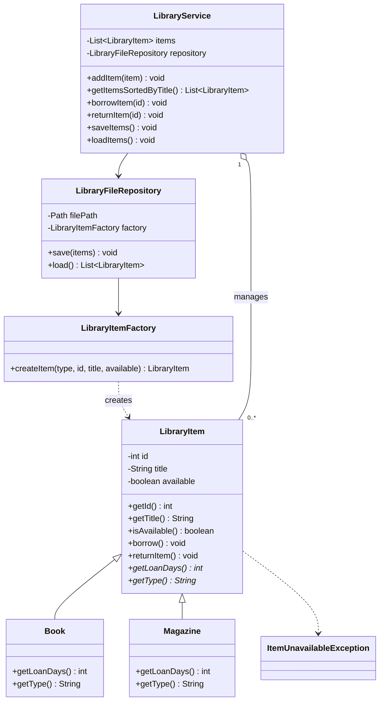

# UML Class Diagram

## Pattern explanation

The project uses the **Factory** pattern. `LibraryItemFactory` is responsible for creating the correct concrete item (`Book` or `Magazine`). This avoids spreading object-creation decisions throughout the application.
